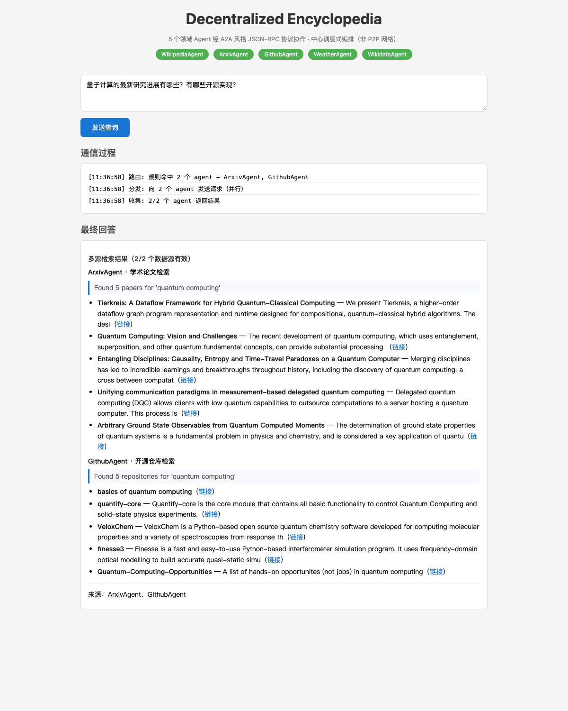

# Decentralized Encyclopedia

**一个多 Agent 协作的跨领域知识问答系统**：5 个领域 Agent 各自独立进程、通过 **A2A v0.3 风格的
JSON-RPC 子集**（Agent Card 发现 / `message/send` / `tasks/get` / `tasks/cancel` / Task 状态机）
接受调度，由一个中心 Coordinator 做路由、并行分发与结果聚合；回答里保留来源与失败信息。

> 这是一个**工程探索项目**，不是生产系统。仓库的重点是：把"多 Agent + 协议"做成**可运行、可测试、
> 可评测、可解释**的东西，并如实标注它与标准协议的差距（见 [`docs/protocol.md`](docs/protocol.md)）。



*示例：一条中文跨领域问题 → 路由命中 arXiv 与 GitLab 两个 Agent → 并行调用 → 按来源分组的聚合结果
（截图来自 `/?q=...` 可分享链接，可直接复现）。*

---

## 这是什么 / 不是什么

| 是 | **不是** |
|---|---|
| 5 个真实外部数据源（DBpedia / arXiv / GitLab / wttr.in / Wikidata）的 Agent 化封装 | 不是"去中心化 P2P 网络"——实际是**中心调度（hub-and-spoke）**，Agent 之间不互相通信 |
| 一个可运行的 A2A **v0.3 风格子集**协议层（Card 发现 + 3 个 JSON-RPC 方法 + 状态机 + 错误码） | **不是 A2A v1.0 兼容实现**（方法名/数据模型/流式均未迁移，逐项列在 `docs/protocol.md`） |
| 121→150 个离线测试、CI（ruff + mypy + coverage 门禁）、契约测试 | 不是生产级：无鉴权体系、无流式、无持久化任务存储、无水平扩展 |
| 一套 4 配置、18 题的跨域评测（见 `docs/eval-report.md`） | 不是"多 Agent 一定更好"的营销——评测显示它只在跨源问题上占优，代价是延迟与调用次数 |

**架构真相**：Coordinator 是 Web 进程内的对象（**没有独立端口**），5 个 domain Agent 是独立进程
（8001–8005），只与 Coordinator 通信。项目名是历史遗留，架构以本节为准。

---

## 架构

```
                       ┌────────────────────────────┐
                       │  Web UI (static, :8000)     │
                       │  /api/query · /api/agents   │
                       └─────────────┬──────────────┘
                                     │ REST（SSE 未实现）
                       ┌─────────────▼──────────────┐
                       │  Coordinator（进程内）       │
                       │  Router → Dispatcher → 聚合  │
                       └─┬────┬────┬────┬────┬─────┘
             A2A JSON-RPC │    │    │    │    │   （Agent Card 发现 + message/send + tasks/*）
        ┌────────────────┘    │    │    │    └────────────────┐
        ▼                     ▼    ▼    ▼                    ▼
 ┌────────────┐      ┌──────────┐ ┌──────────┐ ┌──────────┐ ┌──────────┐
 │ DBpedia    │      │ arXiv    │ │ GitLab   │ │ wttr.in  │ │ Wikidata │
 │ :8001      │      │ :8002    │ │ :8003    │ │ :8004    │ │ :8005    │
 └────────────┘      └──────────┘ └──────────┘ └──────────┘ └──────────┘
```

- **协议层** `src/protocol/`：Agent Card（`/.well-known/agent-card.json`）、JSON-RPC 信封、
  Task 状态机、错误码、`A2AClient`（可注入 `http_client` 做进程内契约测试）。
- **编排层** `src/orchestrator/`：`Registry`（Card 注册/启停）、`Router`（确定性关键词规则，
  顺序即优先级，可选 LLM 路由）、`Dispatcher`（信号量限流并行 + 超时 + 指数退避重试，
  失败以 `DispatchResult.error` 保留而不是静默丢弃）。
- **Agent 层** `src/agents/`：5 个数据源适配 + `catalog.py`（唯一的 Agent Card 来源）。
- **评测** `eval/`：问题集 × 4 种路由/调度配置，产出 Markdown/JSON 报告。

---

## 协议实现范围（摘要）

| 对齐 A2A v0.3 | 未实现 / 与 v1.0 的差异 |
|---|---|
| Card 路径 `/.well-known/agent-card.json` | 流式 `message/stream`（SSE） |
| `message/send` / `tasks/get` / `tasks/cancel` | push notification、`tasks/resubscribe` |
| `Task{id,status,history,artifacts}`、`Part{kind}`、`Message{messageId}` | A2A **v1.0**（PascalCase 方法名、`supportedInterfaces`、删除 `kind`） |
| 状态机（含终态拒收 `-32004`）与 `-32001/-32002` 错误码 | `A2A-Version` 头、官方 TCK 一致性验证 |

完整对照与迁移清单见 [`docs/protocol.md`](docs/protocol.md)。**对外表述请用"A2A 风格子集"，不要写"实现了 A2A"。**

---

## 评测：多 Agent 到底赢在哪

评测设计：**18 条跨领域中文问题**（单源 / 跨源 / 源缺失 / 歧义），对 **4 种配置**做同题对照；
聚合层保持一致，只改变路由与调度方式（`single` 单 Agent 直答 / `multi_serial` 多源串行 /
`multi_parallel` 多源并行（产品实际路径）/ `all_agents` 固定 5 源上限）。无 LLM、无 LLM judge，
指标全部确定性可复算。完整报告见 [`docs/eval-report.md`](docs/eval-report.md)。

| 指标（18 题） | single | multi_serial | **multi_parallel** | all_agents |
|---|---|---|---|---|
| source_coverage（期望源真实命中率） | 39.3% | 50.0% | **50.0%** | 50.0% |
| keyword_hit（内容相关性） | 46.4% | 60.7% | **60.7%** | 60.7% |
| 平均 Agent 调用 / 题 | 1.00 | 1.89 | **1.89** | 5.00 |
| 延迟 p50 / p95（ms） | 964 / 10003 | 2422 / 7319 | **1868 / 6426** | 6010 / 6612 |

**三个结论（含负面）**：

1. **多 Agent 的结构化收益只出现在跨源题**：`cross_source` 类 coverage 50% → 80%，
   keyword_hit 50% → 90%——收益来自"多个源同时真的返回内容"，而不是更深的推理。
2. **并行只省时间，不涨覆盖**：与串行相比 coverage/keyword 完全一致，p50 从 2422ms 降到 1868ms。
3. **多 Agent 不是免费的**：`ambiguous` 类路由 precision 100% → 50%、调用翻倍但覆盖不升；
   `missing_source` 类**100% 仍返回非空结果**——规则路由没有弃答能力，这是明确的下一步（需要
   相关性判定，而不只是"有没有内容"）。

> ⚠️ 口径说明：评测使用 live 公网 API，本轮外部限流明显（arXiv 429、GitLab 429），
> 失败率约 38.6%；为在 5 分钟内完成 4 配置对照，评测关闭了重试（产品默认 `max_retries=1`），
> 因此**绝对覆盖偏低、可作为配置间相对比较**。失败样本全部保留，未剔除。
>
> ```bash
> uv run python -m eval.runner      # 复现：约 4–5 分钟
> ```

## 快速开始

```bash
uv sync                          # 安装依赖（Python >= 3.11）
uv run python scripts/start.py    # 启动 5 个 Agent + Coordinator + Web
# 浏览器打开 http://localhost:8000
```

**不需要任何 API key**：默认规则模式（关键词路由 + 规则聚合），5 个数据源均为免密公开 API。
可选配置 LLM（用于查询分解/路由/聚合）见 `.env.example`；**LLM 调用失败会自动降级到规则模式**，
不会 500（这条有单测覆盖）。

### 示例问题（可直接用 `/?q=` 分享链接）

- `量子计算的最新研究进展有哪些？有哪些开源实现？` → arXiv + GitLab
- `爱因斯坦在哪所大学任教？` → DBpedia + Wikidata
- `北京现在天气怎么样？` → wttr.in

### 各数据源状态

| Agent | 数据源 | 中文支持 | 备注 |
|---|---|---|---|
| WikipediaAgent | DBpedia Lookup | 词典/LLM 翻译后检索 | 英文关键词命中率明显更高 |
| ArxivAgent | arXiv API | 同上 | 会被上游限流（429），失败会显式标出 |
| GithubAgent | GitLab API | 同上 | **数据源是 GitLab，不是 GitHub** |
| WeatherAgent | wttr.in | 内置常见城市名映射 | 中文城市名会映射为英文 |
| WikidataAgent | Wikidata API | 直接支持中文 | API 不可用时回退本地快照，结果标注 `source: local-mock` |

---

## 测试与工程

```bash
uv run pytest tests/ -q                  # 150 个测试，全离线，约 4s
uv run ruff check .                      # lint
uv run mypy src                          # 类型检查（无 ignore 豁免）
uv run pytest tests/ -q --cov=src        # 覆盖率（门禁 80%，当前约 85%）
```

- 契约测试：`tests/test_integration.py`（client ↔ server、错误码、终态语义、mock 标注）
  与 `tests/test_agent_cards.py`（Card 必填字段与可发现性）。
- CI：`.github/workflows/ci.yml`（Python 3.11，ruff → mypy → pytest + coverage 门禁）。
- 所有外部 HTTP 在测试中都被 mock 或用 `httpx.ASGITransport` 进程内调用，**CI 不联网**。

---

## 已修复的真实缺陷（失败分析）

| # | 缺陷 | 现象 | 修法 |
|---|---|---|---|
| 1 | LLM 调用失败未降级 | 配了无效 key 时 `/api/query` 直接 500 | 分解/聚合均捕获 `LLMProviderError` 并降级到规则模式，单测覆盖 |
| 2 | 客户端吞掉 JSON-RPC error | 上游报错时仍硬编码 `state=completed` | `A2AClient` 解析 error body、抛 `A2AError`；非 2xx 也解析错误 |
| 3 | Wikidata 永久 403 | 无描述性 UA / 无联系方式，永远走 mock | UA 带项目 URL（Wikimedia robot policy），恢复真实 API |
| 4 | 中文查询翻译成空串 | 全 CJK 问题被词典清空 → 检索空结果 | 翻译为空时回退原查询；新增常见实体/城市名映射 |
| 5 | Agent Card 全为空 | 启动脚本手拼 `description=''`, `skills=[]`，能力不可发现 | Card 收敛到 `catalog.py`，含 description/skills/tags |
| 6 | "Coordinator: port 8010" 假日志 | 8010 无服务 | 修正启动输出；Coordinator 明确为进程内对象 |
| 7 | 死代码 | `streaming.py` + `sse-starlette` 从未被使用 | 删除并在协议文档声明"未实现流式" |

---

## 已知限制

- **不是 A2A v1.0**：方法名是 v0.3 风格，未实现流式/推送；不要用于跨实现互操作场景。
- **不是"去中心化"**：单点 Coordinator，Agent 之间不通信；Coordinator 是单点故障。
- **任务不持久化**：`TaskStore` 为进程内 TTL 存储，重启即丢。
- **无鉴权体系**：仅可选共享 `X-A2A-API-Key`。
- **规则路由有天花板**：词典覆盖有限（中文实体/城市名做了映射，但长尾问题会漏）；
  未配置 LLM 时聚合是确定性拼接，不是"综合判断"。
- **外部 API 的可用性会波动**：arXiv 限流、Wikidata 偶发 403，失败会被显式标出而不是隐藏。

## Roadmap

1. 迁移到 **A2A v1.0**（PascalCase 方法名 / `supportedInterfaces` / 删除 `kind`），跑官方 `a2a-tck` 的 JSON-RPC 用例。
2. 实现 `message/stream`（SSE）与 `tasks/resubscribe`。
3. 跨 Agent trace（OpenTelemetry span 树：router → agent → aggregate）。
4. 评测扩展：跨源冲突类问题（两个源给出不同答案时的裁决策略）。

## License

MIT
